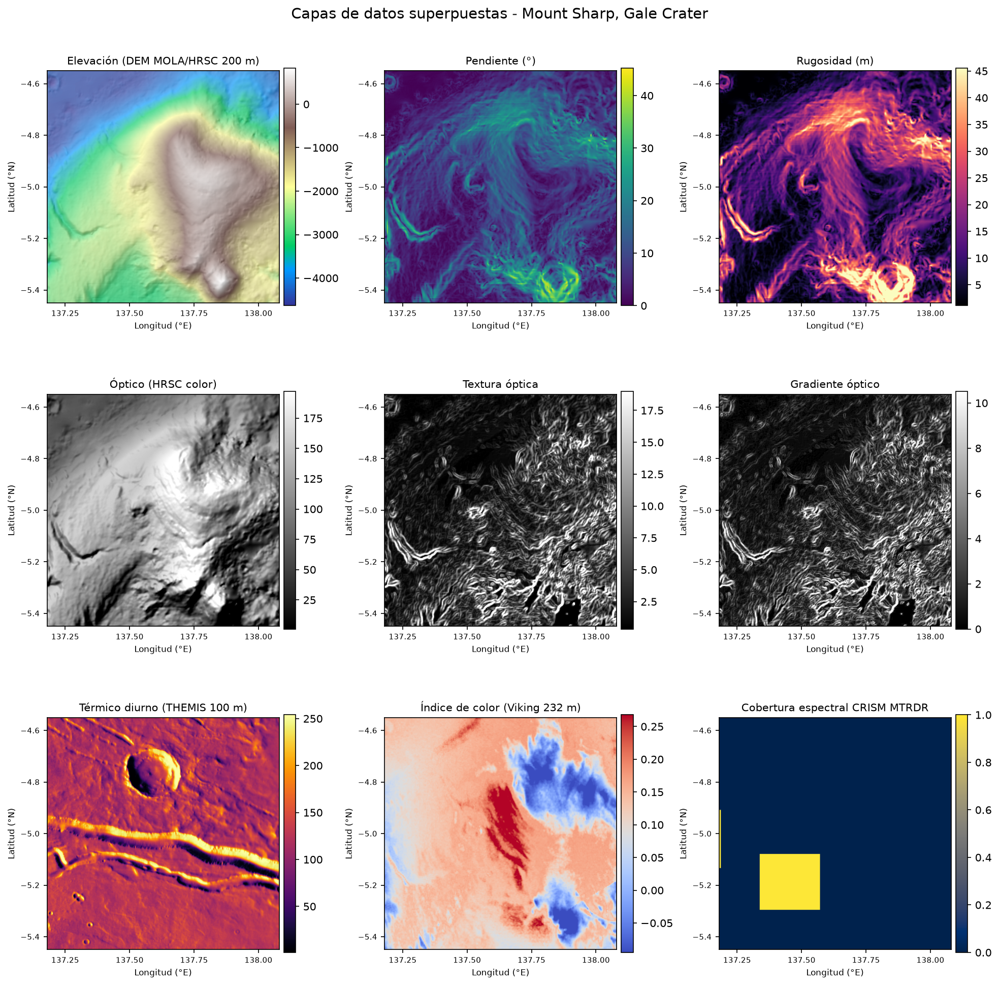
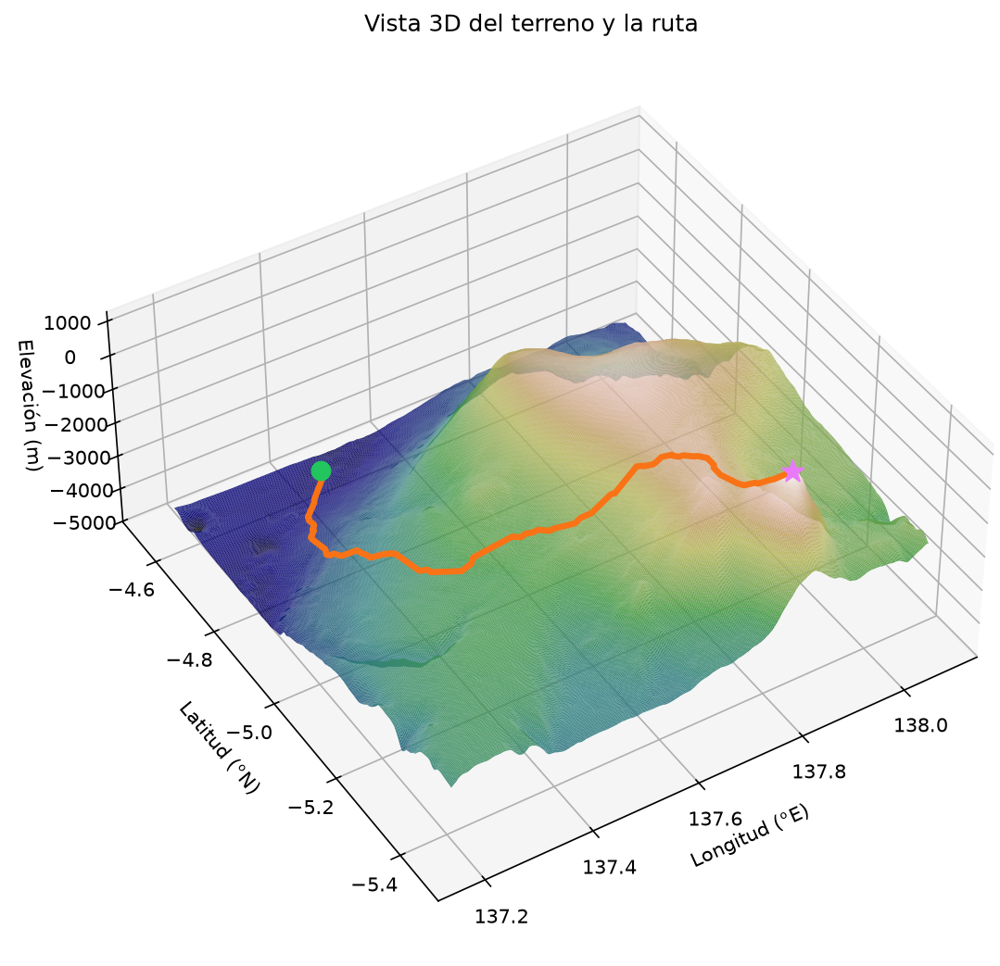

# Mars Route Planner — Mount Sharp, Gale Crater

Modelo base en Python que integra capas de datos orbitales de Marte y calcula una ruta segura desde Bradbury Landing hasta la cumbre de Mount Sharp (Aeolis Mons), Gale Crater. Proyecto para el NASA Space Apps Challenge 2026.


## Área de estudio

| Parámetro | Valor |
|---|---|
| Sitio | Gale Crater, macizo de Mount Sharp (Aeolis Mons) |
| Bounding box | 137.18 °E – 138.08 °E, 5.45 °S – 4.55 °S |
| CRS | Mars 2000 planetocéntrico (EPSG:104905) |
| Extensión | 53.1 km × 53.3 km |
| Grilla | 1200 × 1200 celdas (44.3 m × 44.5 m) |
| Inicio | 137.4416 °E, 4.5895 °S (Bradbury Landing, −4503 m) |
| Objetivo | 137.8599 °E, 5.3709 °S (cumbre, +830 m) |
| Desnivel | +5 333 m |

La cumbre del macizo queda en el extremo sur del área: el DEM de 200 m la sitúa en 137.86 °E, 5.37 °S con 832 m, unos 5.3 km por encima del fondo del cráter. El área incluye el corredor de aterrizaje, el campo de dunas de Bagnold y los flancos norte, oeste y sur del montículo.

## Capas de datos

| Capa | Tipo | Producto | Resolución | Fuente |
|---|---|---|---|---|
| `dem` | Topográfico | MOLA/HRSC blended DEM `Mars_MOLA_blend200ppx_HRSC_DEM` | 200 m | NASA Mars Trek |
| `slope`, `roughness` | Topográfico | Derivadas del DEM | 44 m | Cálculo propio |
| `optical` | Óptico | MOLA/HRSC color shaded relief `..._ClrShade_200mpp` | 200 m | NASA Mars Trek |
| `texture`, `gradient` | Óptico | Derivadas del relieve | 44 m | Cálculo propio |
| `thermal` | Térmico | THEMIS Day IR 100 m | 100 m | ASU JMARS |
| `color_index` | Multiespectral | Viking MDIM 2.1 color | 232 m | NASA Mars Trek |
| `spectral_coverage` | Espectral | Huellas CRISM MTRDR (sitios FRT) | vector | NASA Mars Trek |
| `mineral_distance` | Espectral | Detecciones hidratadas OMEGA/CRISM | puntos | NASA Mars Trek |
| `traverse_distance` | Referencia | Recorrido de Curiosity (19 188 puntos) | 44 m | NASA Mars Trek |
| REMS | Atmosférico | ENVRDR sol 100 y sol 4500 | 1 s | NASA PDS |

Seis tipos de datos se superponen en la misma grilla: topográfico, óptico, térmico, multiespectral, espectral y atmosférico. La cobertura CRISM MTRDR cubre solo el 6.4 % del área (flanco oeste, producto `FRT0000A091_07_IF165J_MTR3`). Hay una detección de minerales hidratados OMEGA/CRISM en el borde oeste del recuadro (137.20 °E, 5.00 °S) y otra fuera, al este.



## Modelo base

Clasificador de bosque aleatorio entrenado con el recorrido real de Curiosity como etiqueta positiva.

- Positivos: celdas a ≤ 60 m del recorrido (995 muestras).
- Negativos: celdas a > 200 m del recorrido con pendiente > 15° o textura óptica sobre el percentil 75 (995 muestras).
- Variables: pendiente, rugosidad, textura óptica, gradiente óptico y térmico. Se excluyen albedo óptico e índice de color como predictoras porque su calibración cambia con la iluminación y la cubierta de polvo entre el corredor de aterrizaje y el macizo; quedan como capas de contexto.
- Bosque de 300 árboles, profundidad 12, mínimo 5 muestras por hoja, clases balanceadas.
- Partición espacial 70/15/15 por progreso a lo largo del recorrido, no aleatoria, para evitar fuga de información.

| Conjunto | Muestras | Positivos | ROC AUC | Average precision | F1 |
|---|---|---|---|---|---|
| Prueba | 928 | 184 | 0.913 | 0.715 | 0.498 |

Importancia relativa: rugosidad 0.45, pendiente 0.43, textura óptica 0.08, gradiente óptico 0.03, térmico 0.01.

## Planificación de ruta

La probabilidad de transitabilidad `p` se convierte en un costo por celda:

```
costo = 1 + 4·(1 − p)² + 3·penalización_pendiente²
```

Se bloquean las celdas con pendiente > 20°, con dos celdas de margen (89 m). La ruta se calcula con A* de 8 vecinos sobre 1.44 millones de celdas y se simplifica con Douglas-Peucker (tolerancia 1.5 celdas).

El umbral duro de probabilidad es 0: el modelo se entrenó en un corredor de 19 km junto al sitio de aterrizaje y no certifica terreno a 47 km de distancia, así que la probabilidad actúa sobre el costo y el veto duro queda en la pendiente.

## Resultados

| Métrica | Modelo aprendido | Referencia solo-pendiente |
|---|---|---|
| Longitud | 72.0 km | 59.0 km |
| Pendiente media | 5.6° | 7.5° |
| Pendiente máxima | 18.0° | 16.6° |
| Rugosidad media | 8.8 m | 11.8 m |
| Transitabilidad media | 0.67 | 0.34 |
| Terreno tipo traverse | 64 % | 21 % |
| Celdas expandidas | 1 121 787 | 466 324 |

La ruta aprendida recorre 13 km más que la referencia, pero duplica la transitabilidad media y triplica la fracción de recorrido sobre terreno comparable al que Curiosity ya atravesó. La referencia corta en diagonal por el flanco norte del macizo; la ruta aprendida rodea el montículo por el oeste, cruza el llano al sur del campo de dunas y asciende por la ladera sur hasta la cumbre.





## Condiciones atmosféricas

REMS registra el ciclo diurno en dos momentos de la misión: temperatura del aire entre 207 y 273 K en el sol 100 y entre 194 y 254 K en el sol 4500, presión media de 840–843 Pa y humedad máxima de 6 % y 23 % respectivamente. La radiación UV máxima cae de 16.6 a 7.8 W/m² por la mayor carga de polvo.


## Aplicación Web Interactiva — GaleX

GaleX es una aplicación **100% web, offline-first** con backend Python local para planificación predictiva y simulación EVA interactiva en Marte.

### Inicio Rápido en un Paso

- **Linux / macOS:**
  ```bash
  ./run_galex.sh
  ```
- **Windows:**
  ```bat
  run_galex.bat
  ```
- **Manual (Cualquier plataforma):**
  ```bash
  python3 backend/server.py
  # Abre http://127.0.0.1:8000 en tu navegador
  ```

### Características de GaleX

1. **Multirregión (Gale y Jezero):**
   - **Cráter Gale (Curiosity / MSL):** Mosaicos de 1200 × 1200 celdas (44 m/celda), Random Forest determinista, 12 capas ráster, refugios Bradbury Landing y Base Mount Sharp.
   - **Cráter Jezero (Perseverance / Mars 2020):** Bounding box georreferenciado, refugios Octavia Butler Landing y Delta Front, con etiquetado de honestidad científica (`NO DISPONIBLE` en capas no cubiertas localmente).
2. **Tres Perfiles de Ruta Multicriterio:**
   - **Segura:** Minimiza riesgo ambiental, pendientes > 15° y exige reserva de oxígeno > 20% al llegar a un refugio verificado.
   - **Rápida:** Minimiza el tiempo de exposición EVA mediante cinemática de Tobler ($v = 6 \cdot e^{-3.5|grade+0.05|} \cdot 0.55$).
   - **Científica:** Maximiza visitas a objetivos geológicos (CRISM, minerales hidratados, sedimentos lacustres).
3. **Restricciones Duras y Soporte Vital:**
   - Obligatoriedad de refugio presurizado verificado al final del trayecto (rechazo automático si la distancia al refugio > 1.0 km).
   - Monitoreo en tiempo real de consumo de $O_2$, batería (Rover presurizado vs Traje EVA) y dosis de radiación ionizante acumulada.
4. **Relieve Planetario 3D (Motor `mars-terreno-3d`):**
   - Coordenadas planetocéntricas ($X = lon$, $Z = -lat$, $Y = elev \cdot exag / 59200$).
   - Streaming dinámico de teselas WMTS MOLA de NASA Mars Trek con zoom por niveles de detalle (LOD 0–6).
   - Modo de contingencia sin conexión: relieve procedural FBM + rampa hipsométrica + muestreo del DEM local de Gale.
   - Controles cinemáticos `flyTo` para Gale, Jezero, Olympus Mons, Valles Marineris y Vista Global.
5. **Red Meteorológica MDA y Replanificación:**
   - Red de estaciones meteorológicas simuladas (`MDA-GALE-01` a `MDA-GALE-22`).
   - Escenario demostrativo Sol 1 (11:30 LTST): tormenta de viento ($28.4\text{ m/s}$) y opacidad ($\tau = 2.15$) en `MDA-GALE-14` (Bagnold Dunes) con alerta explicable y replanificación en 1 clic.
6. **Persistencia SQLite y Bilingüe:**
   - Base de datos relacional `mars_route.sqlite` (`reporte`, `hallazgo`, `mensaje`, `explorador`, `mision`).
   - Botón de alternancia de idioma Español (ES) / Inglés (EN).

### Pruebas de Humo y Verificación

```bash
python3 -m pytest tests/test_smoke.py
```
Ejecuta 7 pruebas exhaustivas que validan contratos de dominio, consistencia de configuraciones de Gale y Jezero, perfiles multicriterio, persistencia SQLite, escenario simulado y cálculo de rutas con restricciones de refugio.

## Estructura
```
config/mission.yaml          parámetros de la misión
config/regions/              configuraciones regionales (Gale y Jezero)
config/route_profiles.yaml   perfiles multicriterio y restricciones duras
data/simulated/              escenario de alertas meteorológicas MDA
src/marsroute/domain.py      modelos de dominio y contratos de datos
src/marsroute/multicriteria.py planificador A* multicriterio y recursos
src/marsroute/storage.py     almacén relacional SQLite
backend/server.py            servidor HTTP/JSON multihilo
backend/schema.sql           esquema SQLite (reporte, hallazgo, etc.)
web/index.html               interfaz web principal
web/css/app.css              estilos responsivos y accesibles
web/js/scene3d.js            motor 3D de teselas planetarias MOLA
web/js/app.js                controlador de interfaz, simulación y alertas
web/js/core.js               algoritmos de soporte y modelos de velocidad
tests/test_smoke.py          suite de pruebas de humo
run_galex.sh / run_galex.bat scripts de inicio en un clic
```
scripts/download_data.py     descarga y recorte de capas
scripts/build_layers.py      construcción de la grilla de capas
scripts/prepare_rems.py      parseo de REMS a CSV
scripts/train_model.py       entrenamiento y métricas
scripts/plan_route.py        costo, A* y evaluación
scripts/make_maps.py         mapas y resumen ambiental
src/marsroute/               geometría, capas, modelo, planificador, evaluación
data/raw/                    datos originales
data/processed/              capas y CSV procesados
models/                      modelo entrenado y métricas
outputs/                     ruta y evaluación en JSON
maps/                        figuras
```

## Reproducción

```powershell
python -m venv .venv
.\.venv\Scripts\activate
pip install -r requirements.txt
python scripts\download_data.py
python scripts\build_layers.py
python scripts\prepare_rems.py
python scripts\train_model.py
python scripts\plan_route.py
python scripts\make_maps.py
```

`download_data.py` descarga un mosaico THEMIS de 632 MB a `data/cache/` (ignorado por git) y lo recorta al área de estudio. Los archivos TAB crudos de REMS (22 MB cada uno) también se excluyen del repositorio; `prepare_rems.py` los convierte en CSV compactos.

## Limitaciones

- El modelo se entrenó con un solo corredor de 19 km; la cumbre está a 47 km y queda fuera de la distribución de entrenamiento, por eso la probabilidad no se usa como veto.
- Los negativos se muestrean solo en celdas peligrosas, así que el modelo ordena riesgo relativo, no transitabilidad absoluta.
- La cobertura espectral CRISM es parcial (6.4 % del área) y las detecciones de minerales hidratados son puntuales.
- La grilla de 44 m no resuelve rocas ni dunas individuales: el campo de Bagnold se cruza por su borde sur.
- REMS cubre dos soles, sin representar todas las estaciones marcianas.
- El costo es estático: no modela el polvo, la visibilidad ni la energía del traje.

## Créditos

NASA/JPL/University of Arizona (HiRISE), Arizona State University (THEMIS, JMARS), NASA Mars Trek, NASA PDS Atmospheres Node (REMS), USGS Astrogeology.
