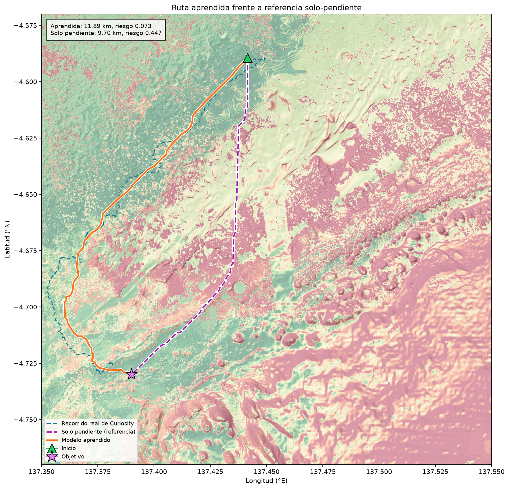
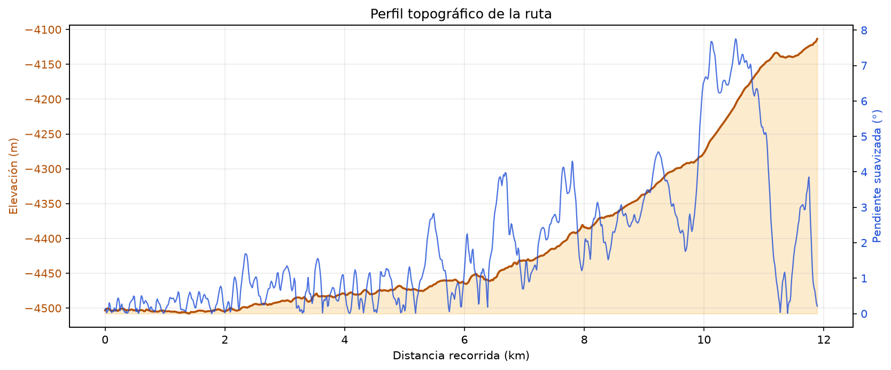
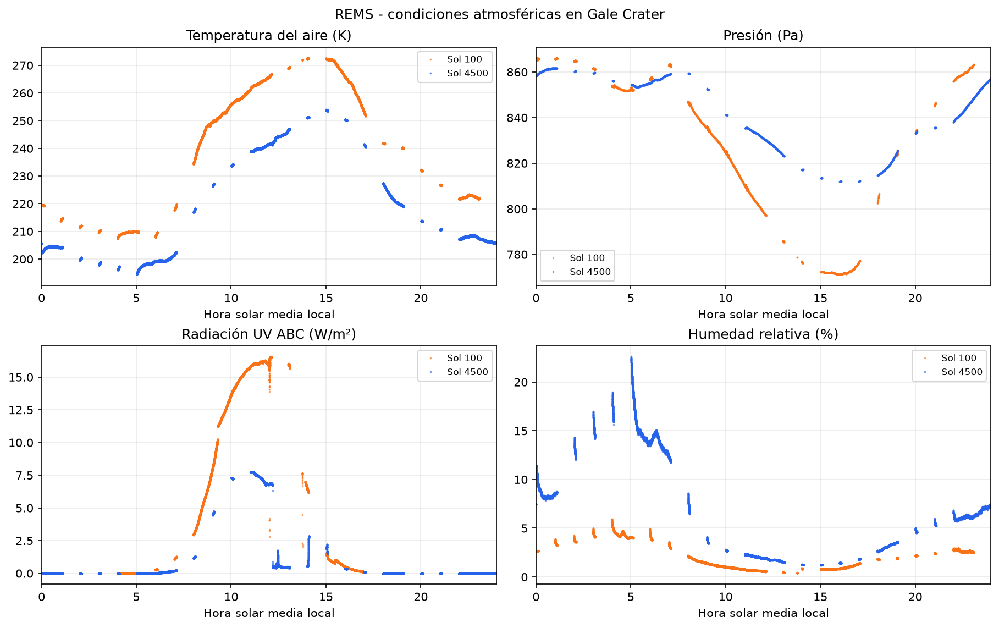

# Mars Route Planner — Gale Crater

Modelo base en Python que integra capas de datos orbitales de Marte y calcula una ruta segura para un astronauta en el flanco norte de Aeolis Mons, Gale Crater. Proyecto para el NASA Space Apps Challenge 2026.


## Área de estudio

| Parámetro | Valor |
|---|---|
| Sitio | Gale Crater, flanco norte de Aeolis Mons |
| Bounding box | 137.35 °E – 137.55 °E, 4.77 °S – 4.57 °S |
| CRS | Mars 2000 planetocéntrico (EPSG:104905) |
| Extensión | 11.8 km × 11.8 km |
| Grilla | 1200 × 1200 celdas (9.9 m) |
| Inicio | 137.4416 °E, 4.5895 °S (Bradbury Landing) |
| Objetivo | 137.3900 °E, 4.7300 °S (base del montículo) |

## Capas de datos

| Capa | Tipo | Producto | Resolución | Fuente |
|---|---|---|---|---|
| `dem` | Topográfico | HiRISE stereo DEM `Gale_DEM_SMG_1m` | 1 m | NASA Mars Trek |
| `slope`, `roughness` | Topográfico | Derivadas del DEM | 9.9 m | Cálculo propio |
| `optical` | Óptico | Mosaico HiRISE `curiosity_hirise_mosaic` | 0.25 m | NASA Mars Trek |
| `texture`, `gradient` | Óptico | Derivadas del mosaico | 9.9 m | Cálculo propio |
| `thermal` | Térmico | THEMIS Day IR 100 m | 100 m | ASU JMARS |
| `color_index` | Multiespectral | Viking MDIM 2.1 color | 232 m | NASA Mars Trek |
| `mineral_distance` | Espectral | Detecciones hidratadas OMEGA/CRISM | puntos | NASA Mars Trek |
| REMS | Atmosférico | ENVRDR sol 100 y sol 4500 | 1 s | NASA PDS |
| `traverse_distance` | Referencia | Recorrido de Curiosity (19 188 puntos) | 9.9 m | NASA Mars Trek |

Los datos crudos están en `data/raw/`. La capa espectral no tiene detecciones dentro del área: las más cercanas están a 18 km, así que se usa como contexto regional y no como restricción local.


## Modelo base

Clasificador de bosque aleatorio entrenado con el recorrido real de Curiosity como etiqueta positiva.

- Positivos: celdas a ≤ 15 m del recorrido (5 959 muestras).
- Negativos: celdas a > 60 m del recorrido con pendiente > 15° o textura óptica sobre el percentil 75 (5 959 muestras).
- Variables: pendiente, rugosidad, textura óptica, gradiente óptico, albedo óptico, térmico e índice de color.
- Bosque de 300 árboles, profundidad 12, mínimo 5 muestras por hoja, clases balanceadas.
- Partición espacial 70/15/15 por progreso a lo largo del recorrido, no aleatoria, para evitar fuga de información.

| Conjunto | Muestras | ROC AUC | Average precision | F1 |
|---|---|---|---|---|
| Validación | 672 | 0.827 | 0.968 | 0.937 |
| Prueba | 3 605 | 0.935 | 0.871 | 0.722 |

Importancia relativa: índice de color 0.35, textura óptica 0.19, rugosidad 0.13, albedo 0.11, pendiente 0.09, gradiente 0.09, térmico 0.05.

## Planificación de ruta

La probabilidad de transitabilidad `p` se convierte en un costo por celda:

```
costo = 1 + 6·(1 − p)² + 3·penalización_pendiente²
```

Se bloquean las celdas con pendiente > 20° o `p` < 0.25, con dos celdas de margen. La ruta se calcula con A* de 8 vecinos y se simplifica con Douglas-Peucker (tolerancia 1.5 celdas).

## Resultados

| Métrica | Modelo aprendido | Referencia solo-pendiente |
|---|---|---|
| Longitud | 11.89 km | 9.70 km |
| Pendiente media | 4.7° | 5.2° |
| Pendiente máxima | 13.9° | 12.8° |
| Riesgo medio | 0.073 | 0.447 |
| Transitabilidad mínima | 0.392 | 0.000 |
| Celdas expandidas | 283 810 | 235 701 |

El modelo recorre 2.2 km más que la referencia, pero reduce el riesgo medio 6.1 veces y evita por completo las dunas y los campos de rocas del sureste. El 59 % de la ruta queda a menos de 150 m del recorrido real de Curiosity (mediana 110 m), lo que valida el corredor elegido.






## Condiciones atmosféricas

REMS registra el ciclo diurno en dos momentos de la misión: temperatura del aire entre 207 y 273 K en el sol 100 y entre 194 y 254 K en el sol 4500, presión media de 840–843 Pa y humedad máxima de 6 % y 23 % respectivamente. La radiación UV máxima cae de 16.6 a 7.8 W/m² por la mayor carga de polvo.



## Estructura

```
config/mission.yaml          parámetros de la misión
scripts/download_data.py     descarga y recorte de capas
scripts/build_layers.py      construcción de la grilla de capas
scripts/prepare_rems.py      parseo de REMS a CSV
scripts/train_model.py       entrenamiento y métricas
scripts/plan_route.py        costo, A* y evaluación
scripts/make_maps.py         mapas y resumen ambiental
src/marsroute/               geometría, capas, modelo, planificador, evaluación
data/raw/                    datos originales
data/processed/              capas y CSV procesados
models/                      modelo entrenado y métricas
outputs/                     ruta y evaluación en JSON
maps/                        figuras
```

## Reproducción

```powershell
python -m venv .venv
.\.venv\Scripts\activate
pip install -r requirements.txt
python scripts\download_data.py
python scripts\build_layers.py
python scripts\prepare_rems.py
python scripts\train_model.py
python scripts\plan_route.py
python scripts\make_maps.py
```

`download_data.py` descarga un mosaico THEMIS de 632 MB a `data/cache/` (ignorado por git) y lo recorta al área de estudio. Los archivos TAB crudos de REMS (22 MB cada uno) también se excluyen del repositorio; `prepare_rems.py` los convierte en CSV compactos.

## Limitaciones

- Los negativos se muestrean solo en celdas peligrosas, así que el modelo ordena riesgo relativo, no transitabilidad absoluta.
- La capa espectral es contexto regional: no hay detecciones de minerales hidratados dentro del área.
- La grilla de 9.9 m no resuelve rocas individuales; el DEM HiRISE de 1 m se usa para calcular pendiente y rugosidad antes de remuestrear.
- REMS cubre dos soles, sin representar todas las estaciones marcianas.
- El costo es estático: no modela el polvo, la visibilidad ni la energía del traje.

## Créditos

NASA/JPL/University of Arizona (HiRISE), Arizona State University (THEMIS, JMARS), NASA Mars Trek, NASA PDS Atmospheres Node (REMS), USGS Astrogeology.
