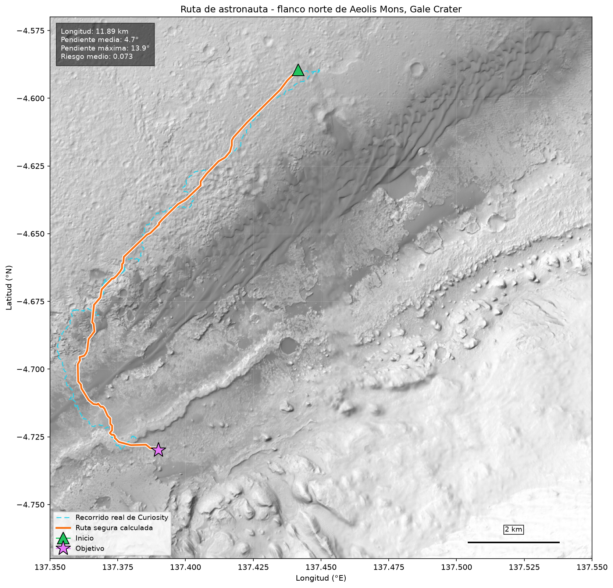
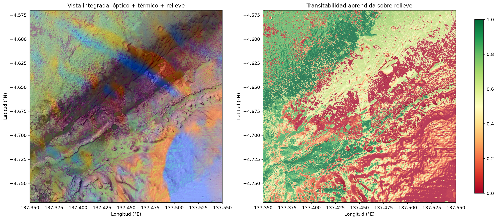

# Mars Route Planner — Mount Sharp, Gale Crater

Modelo base en Python que integra capas de datos orbitales de Marte y calcula una ruta segura desde Bradbury Landing hasta la cumbre de Mount Sharp (Aeolis Mons), Gale Crater. Proyecto para el NASA Space Apps Challenge 2026.



## Área de estudio

| Parámetro | Valor |
|---|---|
| Sitio | Gale Crater, macizo de Mount Sharp (Aeolis Mons) |
| Bounding box | 137.18 °E – 138.08 °E, 5.45 °S – 4.55 °S |
| CRS | Mars 2000 planetocéntrico (EPSG:104905) |
| Extensión | 53.1 km × 53.3 km |
| Grilla | 1200 × 1200 celdas (44.3 m × 44.5 m) |
| Inicio | 137.4416 °E, 4.5895 °S (Bradbury Landing, −4503 m) |
| Objetivo | 137.8599 °E, 5.3709 °S (cumbre, +830 m) |
| Desnivel | +5 333 m |

La cumbre del macizo queda en el extremo sur del área: el DEM de 200 m la sitúa en 137.86 °E, 5.37 °S con 832 m, unos 5.3 km por encima del fondo del cráter. El área incluye el corredor de aterrizaje, el campo de dunas de Bagnold y los flancos norte, oeste y sur del montículo.

## Capas de datos

| Capa | Tipo | Producto | Resolución | Fuente |
|---|---|---|---|---|
| `dem` | Topográfico | MOLA/HRSC blended DEM `Mars_MOLA_blend200ppx_HRSC_DEM` | 200 m | NASA Mars Trek |
| `slope`, `roughness` | Topográfico | Derivadas del DEM | 44 m | Cálculo propio |
| `optical` | Óptico | MOLA/HRSC color shaded relief `..._ClrShade_200mpp` | 200 m | NASA Mars Trek |
| `texture`, `gradient` | Óptico | Derivadas del relieve | 44 m | Cálculo propio |
| `thermal` | Térmico | THEMIS Day IR 100 m | 100 m | ASU JMARS |
| `color_index` | Multiespectral | Viking MDIM 2.1 color | 232 m | NASA Mars Trek |
| `spectral_coverage` | Espectral | Huellas CRISM MTRDR (sitios FRT) | vector | NASA Mars Trek |
| `mineral_distance` | Espectral | Detecciones hidratadas OMEGA/CRISM | puntos | NASA Mars Trek |
| `traverse_distance` | Referencia | Recorrido de Curiosity (19 188 puntos) | 44 m | NASA Mars Trek |
| REMS | Atmosférico | ENVRDR sol 100 y sol 4500 | 1 s | NASA PDS |

Seis tipos de datos se superponen en la misma grilla: topográfico, óptico, térmico, multiespectral, espectral y atmosférico. La cobertura CRISM MTRDR cubre solo el 6.4 % del área (flanco oeste, producto `FRT0000A091_07_IF165J_MTR3`). Hay una detección de minerales hidratados OMEGA/CRISM en el borde oeste del recuadro (137.20 °E, 5.00 °S) y otra fuera, al este.


## Modelo base

Clasificador de bosque aleatorio entrenado con el recorrido real de Curiosity como etiqueta positiva.

- Positivos: celdas a ≤ 60 m del recorrido (995 muestras).
- Negativos: celdas a > 200 m del recorrido con pendiente > 15° o textura óptica sobre el percentil 75 (995 muestras).
- Variables: pendiente, rugosidad, textura óptica, gradiente óptico y térmico. Se excluyen albedo óptico e índice de color como predictoras porque su calibración cambia con la iluminación y la cubierta de polvo entre el corredor de aterrizaje y el macizo; quedan como capas de contexto.
- Bosque de 300 árboles, profundidad 12, mínimo 5 muestras por hoja, clases balanceadas.
- Partición espacial 70/15/15 por progreso a lo largo del recorrido, no aleatoria, para evitar fuga de información.

| Conjunto | Muestras | Positivos | ROC AUC | Average precision | F1 |
|---|---|---|---|---|---|
| Prueba | 928 | 184 | 0.913 | 0.715 | 0.498 |

Importancia relativa: rugosidad 0.45, pendiente 0.43, textura óptica 0.08, gradiente óptico 0.03, térmico 0.01.

## Planificación de ruta

La probabilidad de transitabilidad `p` se convierte en un costo por celda:

```
costo = 1 + 4·(1 − p)² + 3·penalización_pendiente²
```

Se bloquean las celdas con pendiente > 20°, con dos celdas de margen (89 m). La ruta se calcula con A* de 8 vecinos sobre 1.44 millones de celdas y se simplifica con Douglas-Peucker (tolerancia 1.5 celdas).

El umbral duro de probabilidad es 0: el modelo se entrenó en un corredor de 19 km junto al sitio de aterrizaje y no certifica terreno a 47 km de distancia, así que la probabilidad actúa sobre el costo y el veto duro queda en la pendiente.

## Resultados

| Métrica | Modelo aprendido | Referencia solo-pendiente |
|---|---|---|
| Longitud | 72.0 km | 59.0 km |
| Pendiente media | 5.6° | 7.5° |
| Pendiente máxima | 18.0° | 16.6° |
| Rugosidad media | 8.8 m | 11.8 m |
| Transitabilidad media | 0.67 | 0.34 |
| Terreno tipo traverse | 64 % | 21 % |
| Celdas expandidas | 1 121 787 | 466 324 |

La ruta aprendida recorre 13 km más que la referencia, pero duplica la transitabilidad media y triplica la fracción de recorrido sobre terreno comparable al que Curiosity ya atravesó. La referencia corta en diagonal por el flanco norte del macizo; la ruta aprendida rodea el montículo por el oeste, cruza el llano al sur del campo de dunas y asciende por la ladera sur hasta la cumbre.




## Condiciones atmosféricas

REMS registra el ciclo diurno en dos momentos de la misión: temperatura del aire entre 207 y 273 K en el sol 100 y entre 194 y 254 K en el sol 4500, presión media de 840–843 Pa y humedad máxima de 6 % y 23 % respectivamente. La radiación UV máxima cae de 16.6 a 7.8 W/m² por la mayor carga de polvo.


## Aplicación Web Interactiva — GaleX

GaleX es una aplicación **100 % web, offline-first** para planificación predictiva y simulación EVA interactiva en Marte. **Se abre con doble clic en `web/index.html`** (file://), sin servidor: los datos viajan como scripts (`web/data/*.js`), no con `fetch`. El backend Python local es opcional y añade persistencia (SQLite + JSONL), sincronización entre navegadores y la caché de teselas del Planeta 3D.

### Inicio rápido

- **Sin servidor:** abre `web/index.html` en el navegador. Verás «Modo local» en la barra superior.
- **Con backend (Linux / macOS):** `./run_galex.sh`
- **Con backend (Windows):** `run_galex.bat`
- **Manual:**
  ```bash
  python3 backend/server.py
  # Abre http://127.0.0.1:8000 en tu navegador
  ```

### Características de GaleX

1. **Multirregión (Gale y Jezero):**
   - **Cráter Gale (Curiosity / MSL):** grilla de 300 × 300 en el navegador (177 m por celda; 1200 × 1200 y 44 m en el modelo Python), Random Forest determinista, capas ráster, refugios Bradbury Landing y Base Mount Sharp.
   - **Cráter Jezero (Perseverance / Mars 2020):** bounding box georreferenciado, refugios Octavia Butler Landing y Delta Front, con etiquetado de honestidad científica («SOLO GALE» en las capas no cubiertas localmente).
2. **Tres perfiles de ruta multicriterio:**
   - **Segura:** minimiza riesgo ambiental y pendientes > 15°.
   - **Rápida:** minimiza el tiempo de exposición EVA con la función de Tobler adaptada ($v = 6 \cdot e^{-3.5|grade+0.05|} \cdot 0.55$ km/h).
   - **Científica:** maximiza visitas a objetivos geológicos (CRISM, minerales hidratados, sedimentos lacustres).
3. **Radiación como capa de riesgo (modelo simplificado):**
   - Capa «Radiación» (índice relativo de exposición) e indicador en la barra de condiciones, cada uno con su «?» y su fuente.
   - Tasa base de MSL-RAD en el piso de Gale (≈ 0,65 mSv/día, Simonsen, NASA 2024), ajustada por altura y por el cielo visible del relieve. Un evento solar de demostración multiplica la tasa.
   - Dosis EVA acumulada por jornada (solo cuenta las horas al aire libre). Alerta de aviso (50 % del umbral) y crítica (100 %) con **Pausar, Abortar o Volver al refugio**. Umbral configurable en Condiciones → Radiación. La dosis aparece en el resumen final y en el tablero.
   - Cada parámetro dice si es **fuente** o **supuesto**: no es una medición ni un pronóstico. Detalle en `docs/NOTAS_FUENTES.md`.
4. **Validación y confianza del modelo de transitabilidad:**
   - Capa «Confianza del modelo» (desacuerdo entre los 300 árboles del bosque) y fila de confianza en la comparación de rutas.
   - Condiciones → Modelo predictivo: sección «Limitaciones y supuestos» en lenguaje simple (rover frente a astronauta con traje, sesgos de las etiquetas, extrapolación). Detalle y cifras en `docs/LIMITACIONES_MODELO.md`.
5. **Jornada EVA configurable y soles honestos:**
   - Ruta → Jornada EVA: hora de inicio, duración, pausas por hora de marcha y reserva de seguridad. Son **supuestos** (la NASA lista estos parámetros como brechas de conocimiento abiertas).
   - El briefing muestra cuántos soles toma el recorrido (≈ 5 a pie con los valores por defecto) y explica por qué no son 3. La estimación y la simulación usan la misma velocidad. Detalle en `docs/JORNADA_EVA.md`.
   - Movilidad por defecto: **a pie con traje**; el rover presurizado sigue disponible.
6. **Colaboración entre astronautas:**
   - Un hallazgo o una alerta (pendiente o radiación) de un explorador llega a los otros como zona en el mapa, marcador y mensaje en su bitácora. **Cada uno conserva su viaje separado.**
   - Persistencia: `localStorage` (dos pestañas se avisan al instante, también por file://) y, con backend, SQLite (tabla `aviso`) más eventos en JSONL. Detalle en `docs/COLABORACION.md`.
7. **Restricciones duras y soporte vital:** refugio presurizado verificado al final del trayecto (rechazo si la distancia al refugio > 1 km); O₂ y batería a pie medidos **por jornada** (el traje se recarga cada noche: supuesto).
8. **Relieve planetario 3D:**
   - **Relieve 3D** del recuadro de estudio, con el mapa base y la capa activa como textura. Funciona por file://: los mapas base viajan como `data:` URI en `web/data/basemaps_data.js` (carga bajo demanda), porque el navegador no deja usar como textura WebGL una imagen leída de un archivo.
   - **Planeta 3D** (motor `mars-terreno-3d`): teselas MOLA de NASA Mars Trek con zoom por niveles de detalle. Necesita internet o el backend; sin ellos queda el relieve procedural de contingencia. Por file:// la consola puede mostrar bloqueos CORS de las teselas de NASA que no existen.
9. **Red meteorológica MDA y replanificación:** estaciones simuladas (`MDA-GALE-01` a `MDA-GALE-22`) y escenario demostrativo (tormenta en `MDA-GALE-14`, sol 1, 11:30 LTST) con replanificación en un clic.
10. **Persistencia SQLite y bilingüe:** `mars_route.sqlite` (`reporte`, `hallazgo`, `mensaje`, `explorador`, `mision`, `aviso`) y alternancia Español / Inglés.

### Pruebas

**Python** (backend, modelo y avisos):

```bash
python scripts/plan_route.py              # una vez: genera outputs/traversability.npy (ignorado por git)
python -m pytest tests/test_smoke.py tests/test_avisos.py
```

**Navegador** (Playwright; abre `web/index.html` por file://, sin servidor, salvo la prueba del backend):

```bash
pip install playwright                    # usa el Edge/Chrome instalado; no descarga navegadores
python tests/run_web_tests.py             # todas (≈ 3 min)
python tests/run_web_tests.py e2e fase4   # solo algunas
```

| Prueba | Qué comprueba |
|---|---|
| `web_fase1.py` | capa e indicador de radiación, alerta crítica, pausar y volver al refugio |
| `web_fase2.py` | capa de confianza, limitaciones, comparación de rutas |
| `web_fase3.py` | jornada configurable; la simulación completa coincide con la estimación |
| `web_fase4.py` | avisos compartidos sin servidor y con backend (SQLite + JSONL) |
| `web_e2e.py` | recorrido completo: file://, 2D/3D, alerta crítica, hallazgo compartido y resumen |

Todas exigen **cero errores en consola**.

### Datos que se regeneran con scripts

```powershell
python scripts\build_layers.py        # data/processed/layers.npz (ignorado por git)
python scripts\export_uncertainty.py  # confianza del modelo → web/data/uncertainty_data.js
python scripts\export_basemaps.py     # mapas base como data: URI → web/data/basemaps_data.js
```

### Documentación

| Documento | Contenido |
|---|---|
| `docs/NOTAS_FUENTES.md` | qué aporta cada fuente, licencias y tabla de supuestos |
| `docs/LIMITACIONES_MODELO.md` | rover frente a astronauta, sesgos y confianza del modelo |
| `docs/JORNADA_EVA.md` | velocidad de caminata, jornada EVA y cuántos soles toma el recorrido |
| `docs/COLABORACION.md` | avisos compartidos, API, persistencia y límites |

## Estructura

```
config/mission.yaml            parámetros de la misión
config/regions/                configuraciones regionales (Gale y Jezero)
config/route_profiles.yaml     perfiles multicriterio y restricciones duras
data/simulated/                escenario de alertas meteorológicas MDA
src/marsroute/                 geometría, capas, modelo, planificador, evaluación, dominio y almacén SQLite
backend/server.py              servidor HTTP/JSON multihilo (variable MARS_DATA_DIR para otra carpeta de datos)
backend/schema.sql             esquema SQLite (reporte, hallazgo, aviso, etc.)
backend/docstore.py            almacén JSONL (telemetría, objetivos, eventos)
web/index.html                 interfaz web principal
web/css/app.css                estilos responsivos y accesibles
web/js/core.js                 datos, geometría, A*, clima, radiación y jornada EVA
web/js/app.js                  flujo de la expedición, simulación, alertas e interfaz
web/js/shared.js               avisos compartidos entre exploradores
web/js/map2d.js, scene3d.js, globe3d.js   mapa 2D, relieve 3D y Planeta 3D
web/js/api.js, charts.js       cliente del backend y gráficas
web/data/                      datos como scripts (mars_data.js, uncertainty_data.js, basemaps_data.js…)
scripts/download_data.py       descarga y recorte de capas
scripts/build_layers.py        construcción de la grilla de capas
scripts/prepare_rems.py        parseo de REMS a CSV
scripts/train_model.py         entrenamiento y métricas
scripts/plan_route.py          costo, A* y evaluación
scripts/make_maps.py           mapas y resumen ambiental
scripts/export_web.py          exporta capas, rutas y objetivos para la web
scripts/export_uncertainty.py  confianza del modelo (desacuerdo entre árboles)
scripts/export_basemaps.py     mapas base como data: URI para el relieve 3D
tests/                         pruebas de Python y de navegador (ver «Pruebas»)
docs/                          documentación del prototipo
data/raw/                      datos originales
data/processed/                capas y CSV procesados
models/                        modelo entrenado, métricas y resumen de incertidumbre
outputs/                       ruta y evaluación en JSON
maps/                          figuras
run_galex.sh / run_galex.bat   scripts de inicio en un clic
```

## Reproducción

```powershell
python -m venv .venv
.\.venv\Scripts\activate
pip install -r requirements.txt
python scripts\download_data.py
python scripts\build_layers.py
python scripts\prepare_rems.py
python scripts\train_model.py
python scripts\plan_route.py
python scripts\make_maps.py
```

`download_data.py` descarga un mosaico THEMIS de 632 MB a `data/cache/` (ignorado por git) y lo recorta al área de estudio. Los archivos TAB crudos de REMS (22 MB cada uno) también se excluyen del repositorio; `prepare_rems.py` los convierte en CSV compactos.

## Limitaciones

- El modelo se entrenó con un solo corredor de 19 km; la cumbre está a 47 km y queda fuera de la distribución de entrenamiento, por eso la probabilidad no se usa como veto.
- Los negativos se muestrean solo en celdas peligrosas, así que el modelo ordena riesgo relativo, no transitabilidad absoluta.
- La cobertura espectral CRISM es parcial (6.4 % del área) y las detecciones de minerales hidratados son puntuales.
- La grilla de 44 m no resuelve rocas ni dunas individuales: el campo de Bagnold se cruza por su borde sur.
- REMS cubre dos soles, sin representar todas las estaciones marcianas.
- El costo es estático: no modela el polvo, la visibilidad ni la energía del traje.
- La transitabilidad se aprendió del recorrido de un rover, no de un astronauta con traje, y el recorrido lo eligió la ciencia, no la facilidad de paso (`docs/LIMITACIONES_MODELO.md`).
- La radiación, la jornada EVA (08:00–17:00, pausas, reserva) y el consumo del traje son **modelos simplificados con supuestos** rotulados como tales; ninguna cifra de EVA tiene respaldo oficial (`docs/NOTAS_FUENTES.md`, `docs/JORNADA_EVA.md`).
- No hay identidad ni permisos entre exploradores: cualquier cliente puede publicar un aviso como cualquier astronauta (`docs/COLABORACION.md`).

## Créditos

NASA/JPL/University of Arizona (HiRISE), Arizona State University (THEMIS, JMARS), NASA Mars Trek, NASA PDS Atmospheres Node (REMS), USGS Astrogeology.
